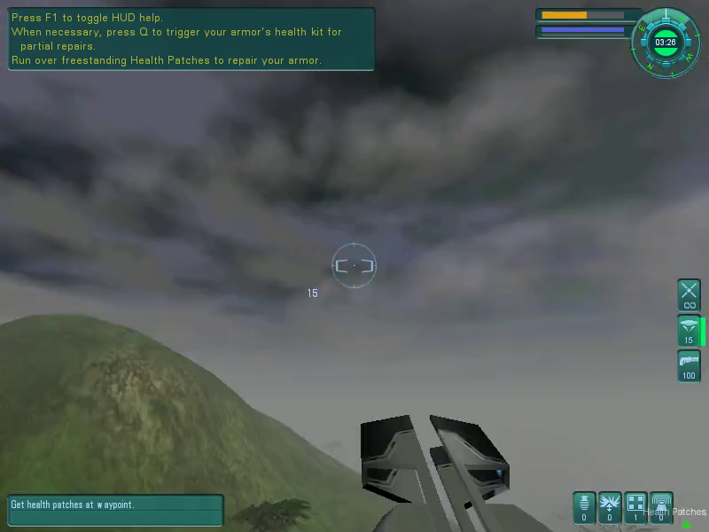
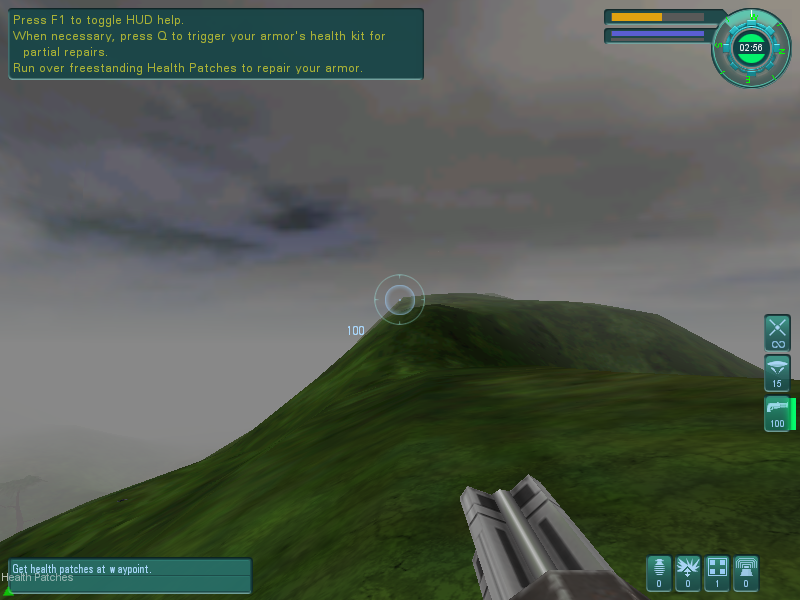
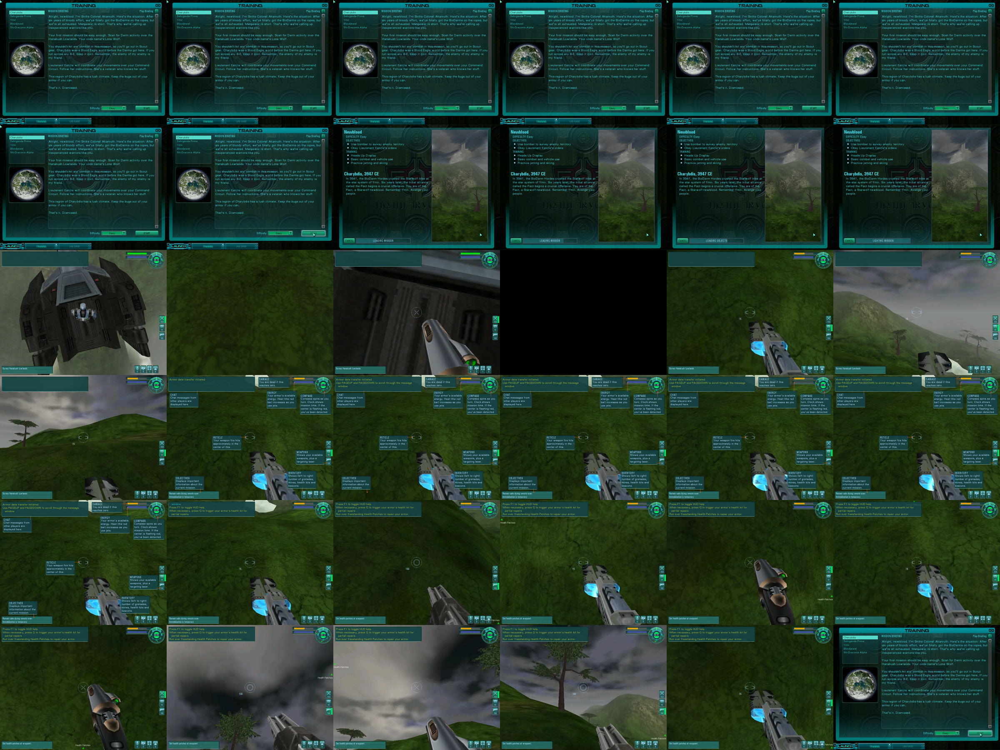

# Tribes 2: Static Recompilation



## What it is

A static recompilation of **Tribes 2** (Dynamix / Sierra, 2001) from its
shipping Windows executable to native C. No emulator, no wrapper DLLs: the
Torque engine, its TorqueScript VM and its OpenGL renderer all run as lifted
C, calling the real `opengl32.dll`.

Built on the [pcrecomp](https://github.com/sp00nznet/pcrecomp) toolchain and
following its house style (layout, CLI, headless mode). The host is the
[Sim Theme Park recomp](https://github.com/sp00nznet/simthemepark-recomp)'s.

**Nothing from the game is in this repository, and no generated source.** You
supply your own copy; the lifted C is generated on your machine into the
gitignored `src/recomp/gen/`.

## Status: v0.1.0-dev, early. IN GAME: Training 1 runs, the player moves, the HUD and its tutorial work.

| Stage | State |
|---|---|
| Version recompiled | `Tribes2.exe` 25034 (October 2002), from Sierra's full installer `tribes2gsi.exe` (the 2004 free release; a Wise installer, unpacked without running it). No disc check. The 2001 CD build also lifts, but its SecuROM 4 helper ends every mission after 10 s ([docs/bringup.md](docs/bringup.md)) |
| Lift | 1 module, 26,042 functions, 0 errors, 6 `aam` unimplemented; pcrecomp `disasm32.py` + `drive32`, seeds from relocated code pointers, no IDA |
| Host (`build\tribes2.exe`, 32-bit, `native32`) | 298 imports bound, 0 unresolved; Miles (`mss32`), Immersion (`IFC22`) and `opengl32` load natively |
| Start-up: volumes (`.vl2`), scripts, prefs, card profiles | works |
| Renderer | the game's OpenGL device on the real driver, windowed 800x600 |
| Licence screen, main menu, warrior setup, training menu | work, with clicks posted to the window |
| Training 1 | **in game**: the bomber drop, the HUD tutorial, walking with posted keys; after a few minutes of the test run the mission ended and returned to the training menu (not yet looked at) |
| Sound | Miles is the real one; `--headless` runs are muted |
| Online | the WON/Sierra servers are gone; run offline with `-- -nologin` |
| Headless (`--headless --shot / --record`) | works: a private desktop, frames read back from the GL back buffer |
| Toolkit | needs pcrecomp's `pcrecomp-tribes2` branch (based on `pcrecomp-stp`), not yet in `main` |
| Setup.cmd, launcher | not written yet |
| netlab | recipe `tribes2-recomp`, not yet built on the farm |

## Screenshots

| | |
|---|---|
|  |  |

A run at a glance, one frame every 10 s (menu, loading, the drop, the tutorial, back to the menu):



## Getting Started

You need **Tribes 2 25034**: the `GameData` folder of an install of Sierra's
free release (`tribes2gsi.exe`, 539 MB; TribesNext links it as the base game
installer, without their client patch). The 2001 CD's `GameData` also lifts,
but stops 10 s into a mission (SecuROM).

Prerequisites: Windows 10/11, **Python 3.10+** with `pefile` and `capstone`,
**Visual Studio 2022** (or its Build Tools) with *Desktop development with
C++*, ffmpeg on `PATH` for `--record` only, and pcrecomp cloned **beside**
this repository on the `pcrecomp-tribes2` branch:

```
some-folder\
  pcrecomp\         <- git clone -b pcrecomp-tribes2 https://github.com/sp00nznet/pcrecomp
  tribes2-recomp\   <- this repository
```

1. `py -3 -m pip install --user pefile capstone`
2. `xcopy /e /i X:\Tribes2\GameData game` (or `mklink /J game <your install>`)
3. `py -3 tools\catalog.py` (about 10 minutes). Expected:
   `[*] Functions: 26042 ...`
4. `py -3 run_lift.py` (about 5 minutes), then `build.cmd`. Expected from the
   lift: `26042 functions in the dispatch table, lift errors 0`.
5. `build\tribes2.exe`. Expected: `[bind] 0x00400000: ... 0 unresolved`.
6. (CD build only) mount the disc or its image: offline play checks the drive.
7. `build\tribes2.exe --run -- -nologin`. The first run shows the licence and
   asks for a warrior name.

## Usage

```
build\tribes2.exe --run -- -nologin
build\tribes2.exe --headless --run --watchdog 300 --shot 60 eula.bmp --click 500,442@60 -- -nologin
```

| Flag | |
|---|---|
| `--run` | enter the game (without it: map, bind and stop) |
| `-- ARGS` | the game's own command line (`-nologin`, `-mission`, `-w`, ...) |
| `--headless` | a private desktop that is never shown (works over RDP); muted unless `PCRECOMP_MUTE=0` |
| `--mute` | mute the audio session |
| `--shot S FILE.bmp` | the frame presented at S seconds (up to 16) |
| `--record FILE.mp4` | every presented frame to ffmpeg |
| `--click X,Y@S`, `--key VK@S` | input at S seconds, posted to the game window |
| `--fullscreen` | let the game change the display mode (by default the mode change is refused and the game runs in a window) |
| `--watchdog S` | stop after S seconds and say where the game was |
| `--conlog` | the engine console on stdout (a `-DT2_TRACE=ON` build) |
| `--game DIR` | the game folder (default `game`) |
| `--native-trace`, `--callbacks` | one line per call into Windows, or back from it |

## Building from source

Steps 3 and 4 above. `PCRECOMP` (Python) and `-DPCRECOMP=` (CMake, through
`set CMAKE_ARGS=...`) point at another toolkit checkout. The generated C
builds at `/Od`. On the farm: `netlab build tribes2-recomp`. What the game
needed, in order, is [docs/bringup.md](docs/bringup.md).

## License

MIT, for the code in this repository ([LICENSE](LICENSE); attributions in
[NOTICE](NOTICE)). Tribes 2 is © Dynamix / Sierra; none of it is here.
