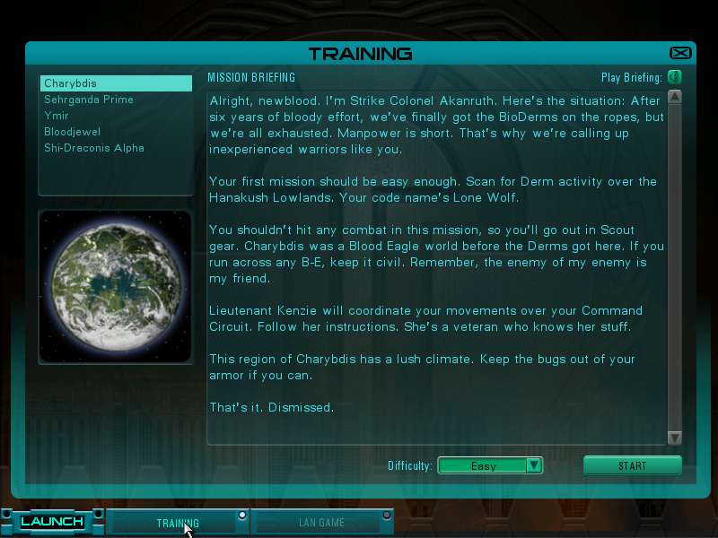
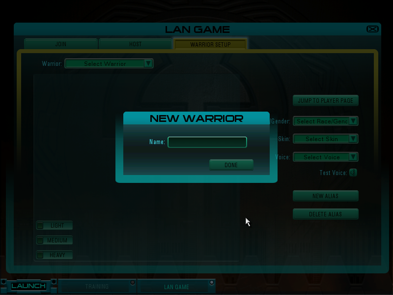
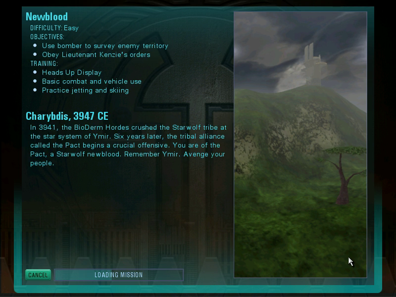

# Tribes 2: Static Recompilation

Static recompilation of **Tribes 2** (Dynamix / Sierra, 2001) from its
shipping Windows executable, `Tribes2.exe` 25034 (the last patch, and the 2004
free release built on it), to native C. No emulator and no wrapper DLLs: the
Torque engine, its TorqueScript VM and its OpenGL renderer run as lifted C,
calling the real `opengl32.dll`.

Built on the [pcrecomp](https://github.com/sp00nznet/pcrecomp) toolchain,
**branch `pcrecomp-tribes2`** (based on `pcrecomp-stp`, not yet in `main`).
The host follows the [Sim Theme Park recomp](https://github.com/sp00nznet/simthemepark-recomp)'s.

## Getting Started

You need **your own copy**: the `GameData` folder of an install of Sierra's
free release of Tribes 2 (`tribes2gsi.exe`, 539 MB, version 25034). The 2001
CD's `GameData` lifts too, but its SecuROM helper quits every mission after
10 seconds, so Setup refuses it. Nothing from the game is in this repository
or downloaded for you; everything is built on your machine from your copy.
Windows only for now.

1. Download this repository (the green **Code** button, then **Download ZIP**)
   and unzip it somewhere with 3 GB free.
2. Double-click **`Setup.cmd`**. It asks before installing anything (Python,
   pefile and capstone, CMake, Ninja, the Visual Studio 2022 Build Tools),
   fetches pcrecomp's `pcrecomp-tribes2` branch beside this folder, asks for
   your `GameData` folder, then catalogs, lifts and builds (20 to 40 minutes,
   once). A rerun skips finished steps; the details go to `setup.log`.
3. Play with **`Tribes 2 (recomp).cmd`** in that folder. It runs offline
   (`-nologin`): the WON servers are gone. The first run shows the license and
   asks for a warrior name.

`setup.sh` only says that there is no Linux or macOS build yet. Building by
hand, the command line and the headless flags are in
**[docs/building.md](docs/building.md)**.

## Status

**v0.1.0-dev, early: in game.** Training 1 runs: the bomber drop, the HUD
tutorial, walking with posted keys. A few minutes into the test run the
mission returned to the training menu; that is not understood yet.

| Stage | State |
|---|---|
| Lift | 1 module, 26,042 functions, 0 errors, 6 `aam` unimplemented; pcrecomp `disasm32.py` + `drive32`, seeds from relocated code pointers, no IDA |
| Host (`build\tribes2.exe`, 32-bit, `native32`) | 298 imports bound, 0 unresolved; Miles (`mss32`), Immersion (`IFC22`) and `opengl32` load natively |
| Start-up: volumes (`.vl2`), scripts, prefs, card profiles | works |
| Renderer | the game's OpenGL device on the real driver, windowed 800x600 |
| License screen, main menu, warrior setup, training menu | work |
| Training 1 | in game; ends early in the test run (see above) |
| Sound | Miles is the real one; `--headless` runs are muted |
| Online | not possible: the WON/Sierra servers are gone |
| Headless (`--headless --shot / --record`) | works: a private desktop, frames read back from the GL back buffer |
| Setup.cmd | works from a fresh clone |
| Linux, macOS | no build yet |
| Conformance harness | none yet; the checks are headless runs ([docs/testing.md](docs/testing.md)) |

[bringup.md](docs/bringup.md) is the log of each wall and its fix, and
[ROADMAP.md](ROADMAP.md) what comes next.

## Screenshots

Recorded headlessly by the recompiled game.

| | |
|---|---|
|  |  |
|  |  |

A run at a glance, one frame every 10 s (menu, loading, the drop, the tutorial, back to the menu):

## Documentation

- [docs/building.md](docs/building.md): building by hand, the command line, the headless flags
- [docs/testing.md](docs/testing.md): the headless checks
- [docs/bringup.md](docs/bringup.md): every wall so far and its fix
- [ROADMAP.md](ROADMAP.md), [CHANGELOG.md](CHANGELOG.md), [CONTRIBUTING.md](CONTRIBUTING.md)

## Contributors

See **[CONTRIBUTORS.md](CONTRIBUTORS.md)** for who did what.

## License

MIT for this repository's own code ([LICENSE](LICENSE)). Tribes 2 is ©
Dynamix / Sierra; none of its files, and nothing generated from them, is in
this repository ([NOTICE.md](NOTICE.md)).
